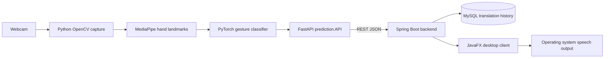

# Architecture and implementation plan

## Components

Python owns camera access, landmark extraction, dataset collection, training, and inference. Spring Boot owns prediction validation, text/history APIs, and persistence. JavaFX owns the desktop screens, text editing, and speech controls.

## Prediction contract (planned)

`POST /predict` accepts a validated landmark payload and returns a gesture label, confidence, timestamp, and status. The backend applies a configurable confidence threshold and does not add rejected predictions to the sentence. `GET /health` and `GET /gestures` report service readiness and the supported vocabulary. Exact request and response schemas will be defined with the FastAPI implementation phase.

The Java client talks only to Spring Boot. The backend talks to FastAPI. This keeps UI code independent from camera/model implementation and keeps MySQL access out of the desktop client.

## Database plan

Translation history will store an identifier, recognized text, optional aggregate confidence, and creation timestamp. No user table is planned unless authentication is added. Schema migrations and the ER diagram will be added with the persistence implementation.

## Version baseline

- Java 21 with Spring Boot 3.5.16 and JavaFX 21.0.7. Spring Boot 3.5 supports Java 17+, while JavaFX 21 aligns with the Java 21 LTS runtime.
- Python 3.11 with bounded dependency ranges in `python-ml-service/requirements.txt`; PyTorch handles gesture classification and MediaPipe handles hand landmarks.
- MySQL 8.4 LTS for local development.

## Phases

1. Requirements and architecture.
2. Project skeleton and configuration.
3. Webcam landmark dataset collection and preprocessing.
4. Model training, validation, testing, and evaluation.
5. FastAPI service and error handling.
6. Spring Boot APIs and database persistence.
7. Python-to-Java service integration.
8. JavaFX user interface.
9. Text construction, speech, and history controls.
10. Integration verification and fixes.
11. Setup, API, diagrams, limitations, and future work documentation.

The first release will support only a small vocabulary with collected or licensed examples. It will not be described as complete ISL translation. Recognition quality will be reported from held-out evaluation data.
